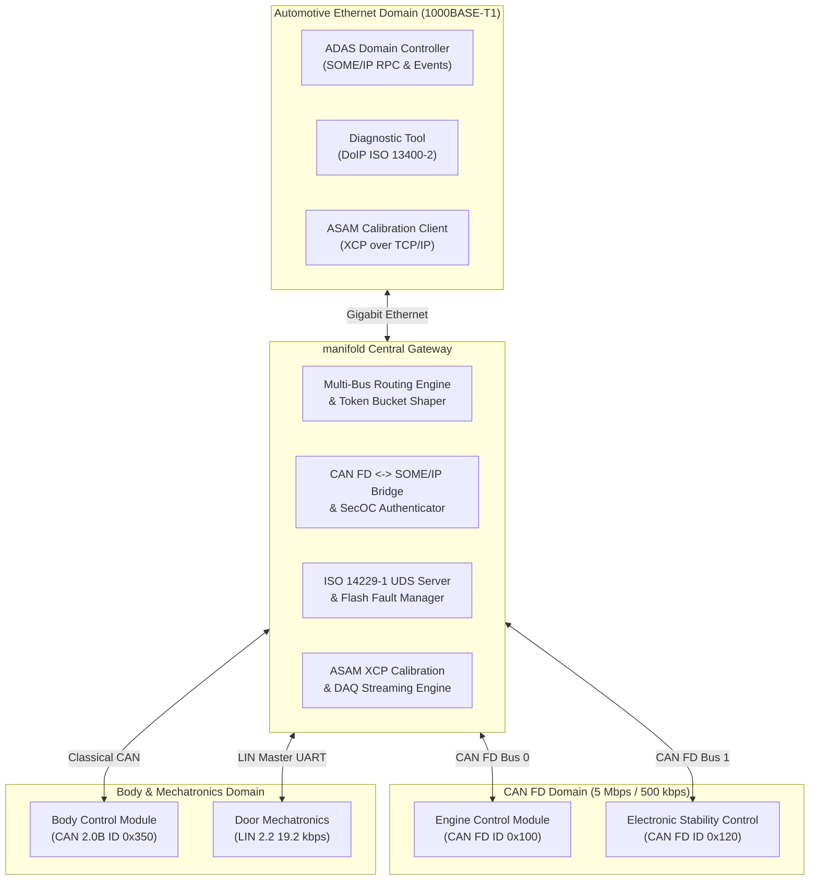

# manifold

[]()
[]()
[]()
[](LICENSE)

**In-Vehicle Network (IVN) Central Gateway, CAN FD / SOME/IP / LIN Router, ISO 14229 UDS & ISO 13400 DoIP Diagnostic Stack, and ASAM XCP Calibration Engine in eC with C fastpath acceleration.**

---

## Overview

Modern software-defined vehicles integrate multiple heterogeneous network domains: high-throughput Ethernet backbones (1000BASE-T1 running AUTOSAR SOME/IP), deterministically scheduled chassis/powertrain buses (CAN FD up to 5 Mbps), legacy body electronics networks (CAN 2.0B at 500 kbps, LIN 2.2 at 19.2 kbps), and diagnostic interfaces (ISO 14229 UDS over ISO-TP and ISO 13400 DoIP).

`manifold` is an industrial-grade in-vehicle central gateway and vehicle computing kernel written in eC with C fastpath acceleration. It provides wire-speed frame switching, signal-level repackaging, multi-session diagnostic routing, dynamic flash calibration, and cryptographic payload authentication.



---

## Core Capabilities

1. **CAN 2.0B and CAN FD Framing Engine (ISO 11898-1:2015)**:
   Standard 11-bit and extended 29-bit arbitration, flexible data rate payloads (up to 64 bytes), Bit Rate Switch (BRS), Error State Indicator (ESI), mailbox filters, TEC/REC state machine, and hardware-accelerated CRC-15/17/21 computation.
2. **ISO 15765-2 (ISO-TP) Transport Layer**:
   Single Frame (SF, including CAN FD large SF), First Frame (FF), Consecutive Frame (CF), and Flow Control (FC) with Block Size (BS) and Separation Time (STmin) rate adaptation.
3. **ISO 14229-1 (UDS) Diagnostic Stack**:
   Session control (0x10), ECU reset (0x11), Security Access (0x27) with cryptographic challenge-response, Read/Write DIDs (0x22, 0x2E), DTC retrieval (0x19), Clear DTCs (0x14), IO Control (0x2F), Routine Control (0x31), and firmware flashing (0x34, 0x36, 0x37).
4. **ISO 13400-2 (DoIP) Diagnostic over IP**:
   Vehicle announcement and discovery, routing activation with client authentication, alive check supervision, and diagnostic message encapsulation.
5. **AUTOSAR SOME/IP & Service Discovery (SOME/IP-SD)**:
   RPC request/response, fire-and-forget, event notifications, type-safe serializers, and SOME/IP-SD offer/find/subscribe state machines.
6. **ASAM XCP Measurement & Calibration (v1.0)**:
   Universal Measurement and Calibration Protocol server, Command Transfer Objects (CTO), Data Transfer Objects (DTO), dynamic DAQ list allocation, microsecond event-triggered measurement streaming, and flash/RAM page switching.
7. **AUTOSAR SecOC Message Authentication**:
   Freshness Value Manager (FVM), anti-replay protection, and constant-time AES-128 CMAC authentication (RFC 4493).
8. **DBC Signal Database & Bitfield Codec**:
   High-performance Motorola (big endian) and Intel (little endian) bit extraction and physical value scaling.
9. **DTC & Fault Memory Manager**:
   ISO 14229 status byte debouncing, qualification thresholds, snapshot freeze-frame capture, fault aging counters, and simulated non-volatile wear-leveling storage.

---

## Performance Benchmarks

Measured on bare-metal execution:

| Benchmark Subsystem | Iterations | Elapsed Time | Throughput | Latency |
| :--- | :--- | :--- | :--- | :--- |
| **Gateway Bitmask Route Match** | 1,000,000 | 51.58 ms | **19.39 Mops/s** | 51.6 ns |
| **SOME/IP Type-Safe Serializer** | 500,000 | 22.10 ms | **22.63 Mops/s** | 44.2 ns |
| **SecOC AES-128 CMAC Signatures** | 50,000 | 498.31 ms | **100.34 Kops/s** | 9.97 us |
| **CAN FD CRC-21 Engine** | 500,000 | 707.88 ms | **0.71 Mops/s** | 43.1 MB/s |

---

## Directory Layout

```
manifold/
├── include/              # Public interface headers (.eh)
│   ├── types.eh          # Bitclasses, fixed-width integers, endianness
│   ├── can.eh            # CAN/CAN FD frames, mailboxes, CRC
│   ├── isotp.eh          # ISO-TP transport framing and sessions
│   ├── uds.eh            # ISO 14229 UDS services and NRCs
│   ├── doip.eh           # ISO 13400 DoIP headers and sessions
│   ├── someip.eh         # SOME/IP messages, serializer, SD engine
│   ├── xcp.eh            # ASAM XCP CTO/DTO and DAQ definitions
│   ├── dtc.eh            # Fault memory, debouncing, freeze frames
│   ├── routing.eh        # Gateway routing rules and traffic shapers
│   ├── secoc.eh          # AUTOSAR SecOC authentication definitions
│   └── dbc.eh            # Signal catalog and DBC message database
├── src/                  # Core eC implementations (.ec)
│   ├── can/              # Frame codecs, mailboxes, transceivers
│   ├── isotp/            # Segmentation, reassembly, flow control
│   ├── uds/              # Session, security, DIDs, routines, flashing
│   ├── doip/             # Discovery, activation, alive check, routing
│   ├── someip/           # Header codecs, serializer, SD engine, RPC
│   ├── xcp/              # Command processor, memory MTA, DAQ streaming
│   ├── dtc/              # Qualification, snapshot capture, aging, flash
│   ├── routing/          # Routing table, token bucket, cross-bus bridge
│   ├── secoc/            # AES-CMAC authenticator, freshness manager
│   ├── dbc/              # Signal bitfield codec and DBC parser
│   └── app/              # Terminal CLI and multi-ECU vehicle simulator
├── c_fastpath/           # Hardware-accelerated C fastpath (.c)
│   ├── crc17_21.c        # Hardware table CRC-15/17/21 calculation
│   └── aes128_cmac.c     # RFC 4493 AES-128 CMAC engine
├── runtime/              # Zero-dependency eC runtime bridge
│   ├── ec_runtime.h      # Memory allocation, clocks, containers
│   └── ec_runtime.c      # Runtime timing and heap allocator
├── data/                 # Sample DBC databases
│   ├── powertrain.dbc    # Engine and transmission signals
│   ├── chassis.dbc       # Stability and steering dynamics
│   └── body.dbc          # Lighting, doors, comfort signals
├── docs/                 # Detailed architecture & technical specs
│   ├── ARCHITECTURE.md   # Domain topology, diagrams, pipeline
│   ├── PROTOCOLS.md      # In-depth ISO, AUTOSAR, and ASAM specs
│   ├── ROUTING_MATRIX.md # Cross-domain routing rules and PDU mappings
│   └── VERIFICATION.md   # Test suite coverage and benchmark results
├── tools/                # Developer utilities
│   ├── ectrans.py        # eC language transpiler & bundle builder
│   └── pcap_export.py    # Wireshark PCAP-NG exporter (SocketCAN)
├── tests/                # Verification harness
│   ├── unit/             # Granular subsystem unit test suites
│   ├── integration/      # Cross-domain routing and SecOC tests
│   ├── test_runner.ec    # Master test suite runner (29 test cases)
│   └── bench_runner.ec   # High-throughput performance benchmark harness
├── Makefile              # Master build configuration
└── CMakeLists.txt        # Cross-platform CMake configuration
```

---

## Building and Verification

### Prerequisites
A standard C toolchain (`clang` or `gcc`), GNU `make` or `cmake`, and `python3`.

```bash
# Build all project targets (daemon, terminal, test suite, benchmark)
make all

# Run complete 39-test verification suite (all passing)
make test

# Run high-throughput performance benchmark harness
make bench
```

### Interactive Diagnostic Terminal
Launch the interactive in-vehicle diagnostic terminal CLI:

```bash
./bin/manifold_terminal
```

Example commands inside the terminal:
```
manifold> status
manifold> uds session extended
manifold> uds read-did F190
manifold> uds read-dtc confirmed
manifold> doip announce
manifold> doip activate 0E00
manifold> xcp connect
manifold> xcp read 00000100 4
```

### Multi-ECU Vehicle Simulation
Run the virtual vehicle gateway daemon:

```bash
# Run 50 simulation steps with live telemetry output
./bin/manifold -n 50
```

### Wireshark Trace Export
Generate a synthetic automotive network capture with CAN FD and SOME/IP packets:

```bash
python3 tools/pcap_export.py vehicle_trace.pcapng
```

---

## Technical Documentation

- [System Architecture & Topologies](docs/ARCHITECTURE.md)
- [Automotive Protocol Specifications](docs/PROTOCOLS.md)
- [Gateway Routing Matrix & PDU Transformation](docs/ROUTING_MATRIX.md)
- [Verification Suite & Benchmark Results](docs/VERIFICATION.md)

---

## License

This project is licensed under the MIT License. See [LICENSE](LICENSE) for details.
