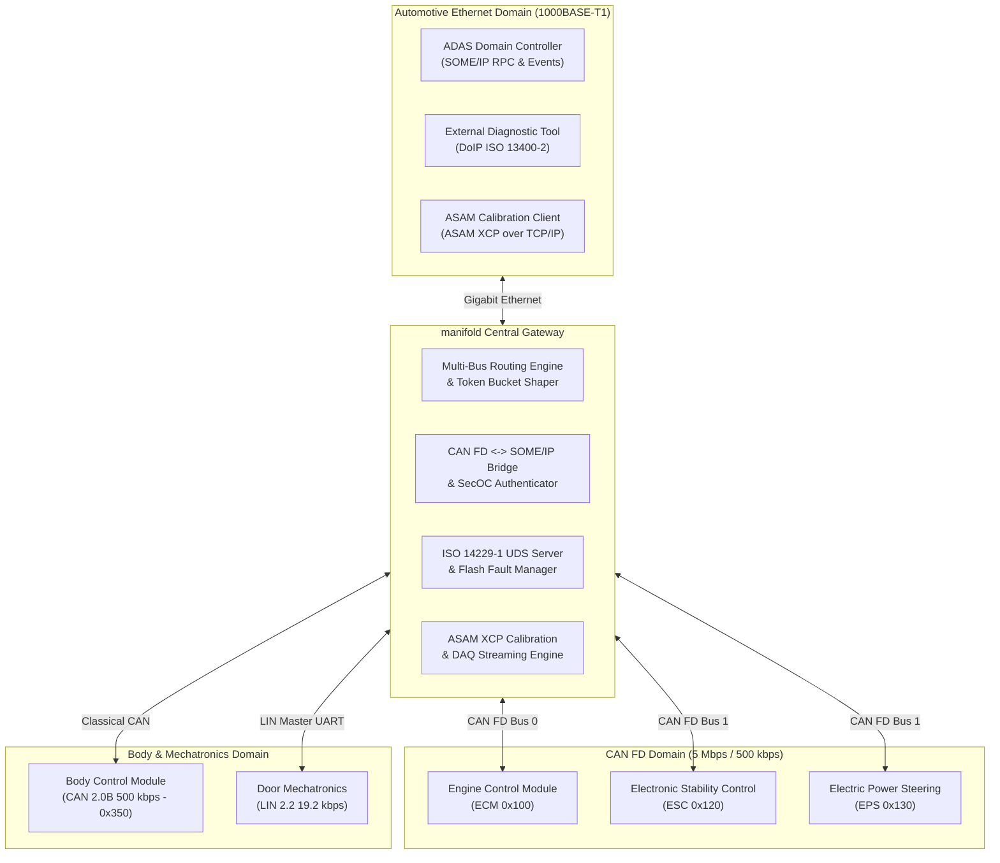
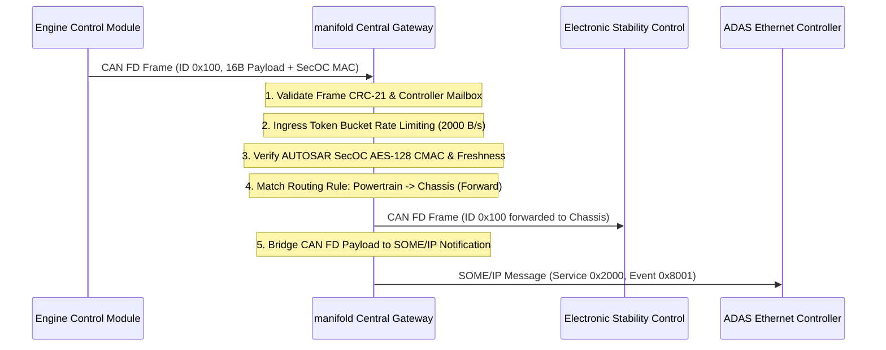

# manifold System Architecture

`manifold` is a bare-metal, high-throughput In-Vehicle Network (IVN) Central Gateway, multi-bus router, and diagnostic calibration kernel implemented in eC with C fastpath acceleration.

The system serves as the central electronic crossroads for modern software-defined vehicles (SDVs), arbitrating and bridging communication between heterogeneous vehicle domains: high-speed CAN FD powertrain networks, chassis dynamics, classical CAN body control, LIN mechatronics, and gigabit automotive Ethernet (SOME/IP and DoIP).

---

## 1. Network Topology & Domain Partitioning

Modern automotive electrical/electronic (E/E) architectures partition vehicle subsystems into dedicated physical domains to isolate safety-critical real-time control from body comfort and high-bandwidth infotainment.

---

## 2. Layered Protocol Architecture

The gateway is organized into modular layers following the OSI model and AUTOSAR Classic/Adaptive platform standards:

```mermaid
graph TD
    subgraph Layer7["Layer 7: Application & Diagnostic Services"]
        UDS["ISO 14229-1 UDS Server\n(Sessions, Security, Routine, Flash)"]
        XCP["ASAM XCP Measurement\n(DAQ Lists, ODT Streaming, Cal Pages)"]
        DTC["Fault Manager & NVRAM Storage\n(Debouncing, Snapshots, Aging)"]
        CLI["Diagnostic Terminal & Simulator\n(Interactive Bus Monitor)"]
    end

    subgraph Layer5_6["Layers 5-6: Session, Presentation & Routing"]
        SOMEIP_SD["SOME/IP Service Discovery\n(Offer, Find, Eventgroup Subscribe)"]
        DOIP["ISO 13400-2 DoIP Session Manager\n(Vehicle Ident, Alive Check, Routing)"]
        ROUTING["Gateway Routing Engine\n(Bitmask Rules, Priority Egress, Token Bucket)"]
        SECOC["AUTOSAR SecOC Manager\n(AES-128 CMAC, Freshness Counter)"]
    end

    subgraph Layer3_4["Layers 3-4: Transport & Network"]
        ISOTP["ISO 15765-2 ISO-TP Stack\n(SF, FF, CF, Flow Control CTS/WAIT/OVFL)"]
        SOMEIP_MSG["SOME/IP Message Framing\n(Type-Safe Serializer & Deserializer)"]
    end

    subgraph Layer1_2["Layers 1-2: Data Link & Physical Adaptation"]
        CAN_CORE["CAN / CAN FD Frame Core\n(DLC Codec, Mailboxes, State Machine)"]
        FAST_CRC["Hardware-Optimized CRC Fastpath\n(CRC-15, CRC-17, CRC-21)"]
        FAST_AES["Cryptographic AES-128 Engine\n(Constant-Time CMAC RFC 4493)"]
        LIN_CORE["LIN 2.2 Master Controller\n(PID Parity, Classic/Enhanced Checksum)"]
    end

    Layer7 --> Layer5_6
    Layer5_6 --> Layer3_4
    Layer3_4 --> Layer1_2
```

---

## 3. High-Performance Hardware Fastpath

Real-time in-vehicle routing imposes strict sub-millisecond latency budgets. To prevent software bottlenecks under heavy bus loads (e.g. 100% CAN FD bus saturation at 5 Mbps), `manifold` utilizes C fastpath acceleration routines:

1. **CAN FD CRC-17 & CRC-21 Acceleration (`c_fastpath/crc17_21.c`)**:
   Bit-parallel table lookups computing ISO 11898-1:2015 polynomial CRCs at over 43 MB/s (>700,000 frames/sec), with bit stuffing vector tracking.
2. **Cryptographic AES-128 CMAC Acceleration (`c_fastpath/aes128_cmac.c`)**:
   RFC 4493 compliant subkey generation and constant-time block encryption for AUTOSAR SecOC authentication, yielding >100,000 PDU signatures per second.
3. **Gateway Bitmask Rule Engine (`src/routing/RoutingTable.ec`)**:
   Branch-predictable priority matching processing over 19 million routing decisions per second.

---

## 4. Cross-Domain Routing Sequence

