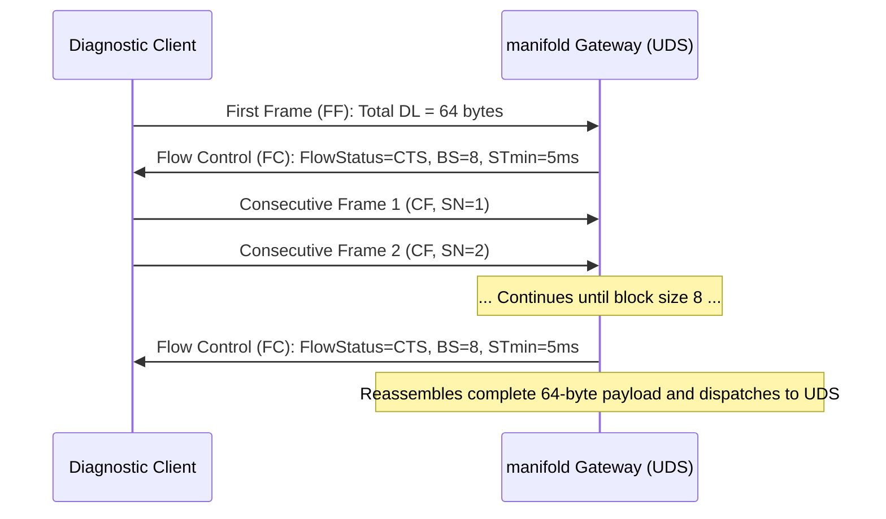

# Automotive Protocols Implemented in manifold

`manifold` implements modern automotive communication, transport, diagnostic, calibration, and security protocols according to official ISO, AUTOSAR, and ASAM standards.

---

## 1. ISO 11898-1:2015 Controller Area Network with Flexible Data-Rate (CAN FD)

CAN FD extends classical CAN to support higher payload bitrates (up to 5 or 8 Mbps) and payloads up to 64 bytes per frame.

- **Arbitration and Bitrate Switching (BRS)**:
  - Nominal bitrate (arbitration phase): 500 kbps.
  - Data phase bitrate: 5.0 Mbps.
- **Data Length Code (DLC) Mapping**:
  Non-linear mapping for lengths > 8: DLC 9 (12B), DLC 10 (16B), DLC 11 (20B), DLC 12 (24B), DLC 13 (32B), DLC 14 (48B), DLC 15 (64B).
- **Cyclic Redundancy Checks**:
  - Classical CAN: CRC-15 ($x^{15} + x^{14} + x^{10} + x^8 + x^7 + x^4 + x^3 + 1$).
  - CAN FD (payload <= 16 bytes): CRC-17 ($x^{17} + x^{16} + x^{14} + x^{13} + x^{11} + x^6 + x^4 + x^3 + x^1 + 1$).
  - CAN FD (payload > 16 bytes): CRC-21 ($x^{21} + x^{20} + x^{13} + x^{11} + x^7 + x^4 + x^3 + 1$).
  - Stuff count calculation: 3-bit Gray code stuff count with parity bit.

---

## 2. ISO 15765-2:2016 Transport Layer (ISO-TP / DoCAN)

ISO-TP segments long diagnostic and calibration PDUs across CAN and CAN FD frames up to 4 GB in length.

- **Frame Types**:
  - `Single Frame (SF)`: 1-byte header for classical CAN (DL <= 7); CAN FD extended format with SF_DL in byte 1 (DL up to 62 bytes).
  - `First Frame (FF)`: 2-byte header with 12-bit payload length (DL up to 4095) or 32-bit escape length for CAN FD (DL up to $2^{32}-1$).
  - `Consecutive Frame (CF)`: 1-byte header containing 4-bit rolling sequence number (SN 0 to 15).
  - `Flow Control (FC)`: 3-byte header specifying FlowStatus (0=CTS, 1=WAIT, 2=OVERFLOW), Block Size (BS), and Minimum Separation Time (STmin).

---

## 3. ISO 14229-1:2020 Unified Diagnostic Services (UDS)

`manifold` implements a full UDS diagnostic server with session management, diagnostic trouble code (DTC) storage, security access, routine execution, and flash reprogramming:

| Service ID | Service Name | Implemented Subfunctions & Capabilities |
| :--- | :--- | :--- |
| **0x10** | DiagnosticSessionControl | Default (0x01), Programming (0x02), Extended (0x03), Safety (0x04) |
| **0x11** | EcuReset | Hard Reset (0x01), KeyOffOn (0x02), Soft Reset (0x03) |
| **0x14** | ClearDiagnosticInformation | Clears DTC fault memory by 3-byte group or all DTCs (0xFFFFFF) |
| **0x19** | ReadDTCInformation | Subfunction 0x01 (count by mask), 0x02 (report by mask), 0x04 (snapshot), 0x06 (extended data) |
| **0x22** | ReadDataByIdentifier | Reads vehicle metrics (VIN 0xF190, Firmware 0xF195, Speed, RPM, Battery) |
| **0x27** | SecurityAccess | Multi-level PRNG challenge-response with lockout supervision |
| **0x28** | CommunicationControl | Enable/disable Rx/Tx per bus domain |
| **0x2E** | WriteDataByIdentifier | Calibration parameter write with security level validation |
| **0x2F** | InputOutputControlByIdentifier | ReturnControlToECU (0x00), ShortTermAdjustment (0x03) |
| **0x31** | RoutineControl | StartRoutine (0x01), StopRoutine (0x02), RequestResults (0x03) |
| **0x34** | RequestDownload | Firmware flash initialization with memory address and uncompressed size |
| **0x36** | TransferData | Block sequence counter tracking and flash memory buffering |
| **0x37** | RequestTransferExit | Finalization and checksum verification of uploaded firmware block |

---

## 4. ISO 13400-2:2019 Diagnostic over IP (DoIP)

DoIP encapsulates UDS diagnostic communication over vehicle Ethernet and IP networks:

- **Generic Header (8 bytes)**: Protocol version (0x02), Inverse version (0xFD), 16-bit Payload Type, 32-bit Payload Length.
- **Vehicle Announcement & Identification (Types 0x0001 - 0x0004)**: 41-byte wire frame broadcasting vehicle VIN, Logical Address (0x0E80), Entity ID (MAC), and Group ID.
- **Routing Activation (Types 0x0005, 0x0006)**: Socket registration handshake binding client Logical Address with authentication.
- **Alive Check Watchdog (Types 0x0007, 0x0008)**: Periodic heartbeat supervision closing dead sockets after timeout.
- **Diagnostic Message Routing (Type 0x8001)**: Logical routing between tester address and target vehicle ECUs with ACK (0x8002) and NACK (0x8003).

---

## 5. AUTOSAR SOME/IP & Service Discovery (SOME/IP-SD)

SOME/IP provides Scalable service-Oriented MiddlewarE over IP for automotive domain controllers:

- **Message Header (16 bytes)**: Service ID, Method/Event ID, Length, Client ID, Session ID, Protocol Version (0x01), Interface Version, Message Type, Return Code.
- **SOME/IP-SD (Service ID 0xFFFF, Method 0x8100)**:
  - OfferService: periodic broadcast announcing available services and endpoints.
  - FindService: client query discovering service instances.
  - SubscribeEventgroup & Ack: publish-subscribe event routing.
- **Type-Safe Serializer**: IEEE 754 float32/float64, big-endian integer primitives, dynamic length-prefixed strings, and structured byte arrays.

---

## 6. ASAM Universal Measurement and Calibration Protocol (XCP 1.0)

ASAM XCP provides direct memory read, write, and synchronous data acquisition (DAQ) for ECU calibration:

- **Command Transfer Objects (CTO)**: Standard commands (CONNECT, GET_STATUS, SET_MTA, UPLOAD, SHORT_UPLOAD, DOWNLOAD, BUILD_CHECKSUM).
- **Dynamic DAQ & ODT Lists**: High-rate event-triggered measurement streaming with microsecond timestamps.
- **Calibration Page Management**: Dual-page architecture switching between immutable Flash Reference Page (Page 0) and read/write RAM Working Page (Page 1).

---

## 7. AUTOSAR Secure On-Board Communication (SecOC)

SecOC protects in-vehicle communication from spoofing, tampering, and replay attacks:

- **Cryptographic Engine**: AES-128 CMAC (RFC 4493 / NIST SP 800-38B).
- **Authentication Vector**: `[DataID (2B) | Authentic Payload (NB) | Freshness Value (8B)]`.
- **Constant-Time Verification**: Prevents timing side-channel attacks during MAC comparison.
