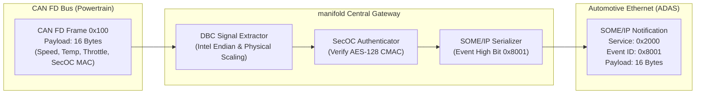

# manifold Gateway Routing Matrix & PDU Transformation

This document details the cross-domain routing tables, bitmask filtering rules, priority arbitration tiers, and PDU repackaging transformations implemented in the `manifold` Central Gateway.

---

## 1. Domain Cross-Connect Architecture

The gateway bridges six distinct physical and logical domains:

| Domain | Bus Technology | Nominal Rate | Data Phase Rate | Primary Function |
| :--- | :--- | :--- | :--- | :--- |
| **Powertrain** | CAN FD | 500 kbps | 5.0 Mbps | Engine, Transmission, Hybrid Inverter |
| **Chassis** | CAN FD | 500 kbps | 5.0 Mbps | Brake (ESC), Steering (EPS), Suspension |
| **Body** | Classical CAN 2.0B | 500 kbps | N/A | BCM, Comfort, Exterior Lighting |
| **LIN Doors** | LIN 2.2 | 19.2 kbps | N/A | Window Lifters, Mirror Actuators, Door Locks |
| **Ethernet** | 1000BASE-T1 | 1.0 Gbps | 1.0 Gbps | ADAS Domain Controller, SOME/IP Services |
| **Diagnostic** | DoIP / ISO-TP | 1.0 Gbps / CAN | N/A | Off-board Tester, OBD-II, UDS Services |

---

## 2. Ingress Bitmask Routing Rules

Routing decisions are evaluated using 32-bit bitmask matching. When multiple rules match an ingress identifier, the rule with the highest numerical priority is executed.

| Source Domain | Source CAN ID | Mask | Destination Domain | Dest CAN ID | Action | Priority | Rate Limit |
| :--- | :--- | :--- | :--- | :--- | :--- | :--- | :--- |
| **Powertrain** | `0x100` (ECM) | `0x7FF` | **Chassis** | `0x100` | FORWARD | 10 | 2000 B/s |
| **Powertrain** | `0x110` (TCU) | `0x7FF` | **Chassis** | `0x110` | FORWARD | 10 | 1000 B/s |
| **Chassis** | `0x120` (ESC) | `0x7FF` | **Body** | `0x350` | TRANSLATE_ID | 20 | 1000 B/s |
| **Chassis** | `0x130` (EPS) | `0x7FF` | **Powertrain** | `0x130` | FORWARD | 15 | 1000 B/s |
| **Body** | `0x350` (BCM) | `0x7FF` | **LIN Doors** | `0x20` (PID) | REPACKAGE_PDU | 5 | 250 B/s |
| **Powertrain** | `0x700` | `0x700` | **Chassis** | `0x000` | DROP | 50 | None |

---

## 3. CAN FD to SOME/IP Semantic Bridge Mapping

For cross-domain communication between CAN FD control buses and Ethernet domain controllers, the gateway unpacks CAN FD signal PDUs using the DBC catalog and repacks them into serialized SOME/IP notification events:

| Source CAN ID | DBC Message Name | Dest Service ID | Method / Event ID | Type | Target Consumer |
| :--- | :--- | :--- | :--- | :--- | :--- |
| `0x100` | `EngineStatus` | `0x2000` | `0x8001` (Event) | NOTIFICATION | ADAS Autonomous Driving Unit |
| `0x120` | `VehicleDynamics` | `0x2000` | `0x8002` (Event) | NOTIFICATION | Electronic Horizon & Navigation |
| `0x350` | `BodyControlStatus` | `0x3000` | `0x8001` (Event) | NOTIFICATION | Digital Cockpit / Infotainment |

---

## 4. Traffic Shaping & Egress Queue Parameters

To prevent burst-induced bus lockouts on lower-speed buses (e.g. bridging 5 Mbps CAN FD bursts onto a 500 kbps Classical CAN bus), the gateway employs leaky/token bucket rate limiters:

- **Powertrain Ingress Shaper**: Capacity = 500 bytes, Refill Rate = 2000 bytes/sec.
- **Chassis Ingress Shaper**: Capacity = 400 bytes, Refill Rate = 1500 bytes/sec.
- **Priority Egress Queue**: 64-frame capacity, strict priority sorting (Priority 10 > Priority 5 > Priority 1).
